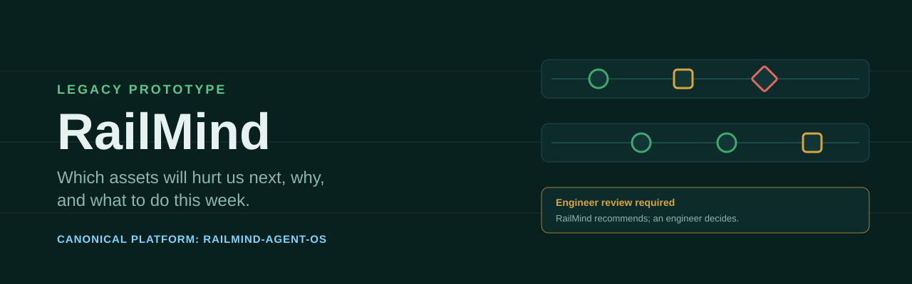
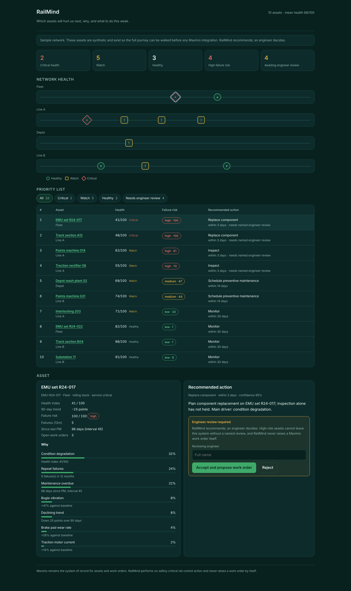
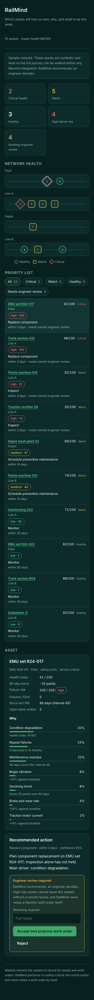
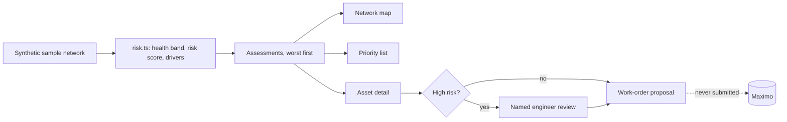

<p align="center"></p>

# RailMind

Rail maintenance decision intelligence: a React prototype that ranks assets by failure risk, explains why, and keeps every recommendation behind a named engineer review.

<p align="center"><br><sub><em>Concept image (AI-generated). Not a product screenshot.</em></sub></p>


> **Canonical platform:** [`RailMind-Agent-OS`](https://github.com/ahmadzayan-hub/RailMind-Agent-OS) is the canonical RailMind platform. This repository is the legacy asset-intelligence prototype and a migration source only. Its health and failure-risk engine has been migrated into RailMind Agent OS. New work belongs there.

> Which assets will hurt us next, why, and what should we do this week.

## Overview

RailMind is an **intelligence layer over Maximo, not a replacement for it.**
The asset register and work orders stay where they belong; RailMind adds the
decision: a health index, a failure risk with named drivers, and a
recommended action that a human engineer reviews before it goes anywhere.

The app runs entirely in the browser on a **synthetic sample network** of 10 assets. There is no backend, no Maximo connection and no data leaves the page.

### Product authority

| | |
|---|---|
| **Primary User** | Chief engineer / maintenance director and their reliability engineers |
| **Job To Be Done** | Decide which assets to act on this week, with evidence |
| **System of Record** | Risk assessments, drivers, recommendations, engineer reviews, outcomes |
| **System of Intelligence** | Health scoring, failure-risk forecasting, driver attribution, prioritisation |
| **Explicit Non-Goals** | Replacing Maximo · operational or signalling control · generic BI · contract compliance (→ VERTEX) |

Full statement: [`docs/PRODUCT_AUTHORITY.md`](docs/PRODUCT_AUTHORITY.md).

### The rule that outranks every feature

RailMind **recommends**; an engineer **decides**. A recommendation on a
high-risk asset cannot leave the system without named engineer review, and
RailMind performs no safety-critical rail control action of any kind. It
*proposes* a Maximo work order; it never raises one by itself.

## Key features

- **Network summary**: counts of critical, watch and healthy assets, high failure risk, and assets awaiting engineer review.
- **Network health map**: assets per line or area; state is carried by shape and label as well as colour.
- **Priority list**: every asset ordered by failure risk (highest first), with health, risk score and recommended action. Filter by Critical, Watch, Healthy or Needs engineer review. Selecting a row opens its assessment.
- **Asset assessment**: health index, 90-day trend, failure risk, PM status and the weighted drivers behind the score.
- **Engineer-review gate**: high-risk recommendations need a named reviewer before a Maximo work-order *proposal* is produced. The proposal is never submitted.
- **Deterministic engine** in `src/domain/risk.ts`, covered by unit tests.

## Screenshots

Captured from the production build (`npm run build && npm run preview`) with the synthetic sample network.

| Desktop (1440 wide, full page) | Mobile (390 wide, full page) |
|---|---|
|  |  |

## Quick start

Requirements: Node.js 22.

```bash
npm ci
npm run dev       # http://localhost:5173
```

## Scripts

| Script | Purpose |
|---|---|
| `npm run dev` | Vite dev server |
| `npm run build` | Type-check (`tsc -b`) and build to `dist/` |
| `npm run preview` | Serve the production build |
| `npm run typecheck` | `tsc --noEmit` |
| `npm run lint` | ESLint |
| `npm test` | Vitest (domain and UI journey tests) |

CI (`.github/workflows/ci.yml`) runs typecheck, lint, tests and build on Node 22.

## Project structure

```text
src/
  App.tsx                  page layout and selection state
  components/
    NetworkMap.tsx         network health map
    PriorityList.tsx       filterable list ordered by failure risk
    AssetDetail.tsx        assessment, drivers and engineer-review gate
    labels.ts              shared action and time labels
  domain/
    risk.ts                health band, risk score, drivers, recommendation
    maximo.ts              work-order proposal (never submitted)
    types.ts               domain model
  data/sample-network.ts   synthetic sample assets
tests/                     Vitest suites (risk, maximo, app journey)
docs/PRODUCT_AUTHORITY.md  product statement
```

## Architecture



## Deploy on Vercel

`vercel.json` is already configured. Settings:

| Setting | Value |
|---|---|
| Framework preset | Vite |
| Root directory | `./` (repository root) |
| Install command | `npm ci --no-audit --no-fund` |
| Build command | `npm run build` |
| Output directory | `dist` |
| Environment variables | none |

`vercel.json` also sets security headers (CSP, frame denial, nosniff), long-lived caching for `/assets/*` and a single-page rewrite to `index.html`.

## Status and known limitations

- Legacy prototype. Superseded by [RailMind-Agent-OS](https://github.com/ahmadzayan-hub/RailMind-Agent-OS), which is the canonical platform.
- All assets are synthetic. Weights and thresholds are demo values and uncalibrated.
- No Maximo integration, no backend and no persistence. Reviews and proposals reset on reload.
- English only.

Original roadmap, kept for reference (now pursued in RailMind Agent OS):

- **P0 · See the risk**: network health map, asset view with drivers and evidence, recommendations behind the engineer-review gate, sample dataset so the product is explorable before any integration.
- **P1 · Real data**: Maximo read integration, condition-monitoring feed, CSV/XLSX import, outcome capture.
- **P2 · Learn**: forecast accuracy tracking, driver calibration, evaluation packs run through the AI Assurance Lab.

KPI: `maintenance decisions that prevented a measurable failure or cost`

## Arabic summary

<div dir="rtl" lang="ar">

**RailMind** نموذج أولي سابق لذكاء قرارات صيانة السكك الحديدية. يرتّب الأصول حسب خطر الأعطال، ويوضح أسباب التقييم، ولا يسمح بأي توصية عالية الخطورة دون مراجعة مهندس باسمه الصريح. يقترح أمر عمل في Maximo ولا يرسله أبدًا.

جميع البيانات في هذا المستودع اصطناعية لأغراض العرض. المنصة المعتمدة حاليًا هي مستودع **RailMind-Agent-OS**، وهذا المستودع مرجع للترحيل فقط.

</div>

## Ownership

Owned and maintained by Ahmed Zaian. No license file is included; all rights reserved unless the owner states otherwise.
